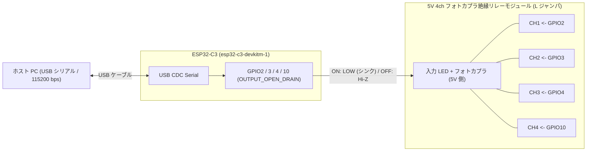
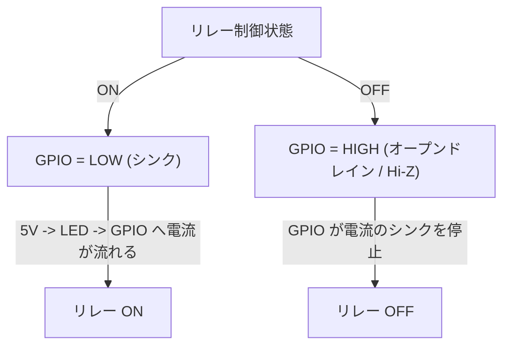
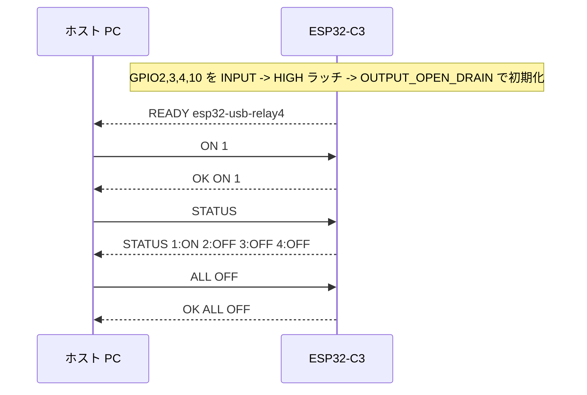

# esp32-usb-relay4

USB シリアル（USB CDC）経由で ESP32-C3 を制御し、4ch フォトカプラ絶縁リレーモジュールの ON/OFF を行う PlatformIO + Arduino プロジェクトです。

## 構成・動作環境

- **プラットフォーム / フレームワーク**: `espressif32` / Arduino（[platformio.ini](platformio.ini)）
- **ターゲットボード**: `esp32-c3-devkitm-1`（PlatformIO 環境名: `esp32-c3-mini-1`）
- **通信インターフェース**: USB CDC（`ARDUINO_USB_MODE=1`, `ARDUINO_USB_CDC_ON_BOOT=1`）
- **シリアル設定**: `115200 bps`（アップロード速度: `460800 bps`）

## システム構成図



## ハードウェア設計と GPIO 割り当て

[src/main.cpp](src/main.cpp) におけるリレー出力のピン割り当ては以下の通りです。

| チャンネル | GPIO |
| :--- | :--- |
| Channel 1 | `GPIO2` |
| Channel 2 | `GPIO3` |
| Channel 3 | `GPIO4` |
| Channel 4 | `GPIO10` |

### 駆動方式（Active-Low / オープンドレイン）

- 5V フォトカプラ絶縁リレーモジュールを **L ジャンパ（Low-level trigger）** 設定で使用する前提です。
- 3.3V の HIGH 出力ではモジュール側の入力 LED とフォトカプラ LED を直列に駆動する電圧が不足するため、全チャンネルを `OUTPUT_OPEN_DRAIN`（Active-Low）で制御しています。
  - **ON**: `LOW` を出力して電流をシンク
  - **OFF**: オープンドレイン出力で `HIGH` を設定し、GPIO をハイインピーダンスにします。モジュール側から GPIO にかかる電圧は ESP32-C3 の入力電圧仕様内に収めてください。
- ファームウェア起動時は `INPUT` → 非アクティブレベル（`HIGH`）のラッチ → `OUTPUT_OPEN_DRAIN` の順で初期化します。ESP32-C3 の電源投入時にはファームウェア実行前に GPIO10 が短時間 LOW になる場合があります。使用する負荷を接続する前に、起動時のリレー動作を実機で確認してください。[ESP32-C3 データシート（表 2-2、表 5-4）](https://documentation.espressif.com/esp32-c3_datasheet_en.html)
- 起動後、USB シリアル接続を最大 1500ms 待機したうえで `READY esp32-usb-relay4` を出力します。
- USB シリアル接続が切れても、ESP32-C3 とリレーに給電が続く間は最後に設定した出力状態を保持します。



## ビルド・書き込み・モニター

PlatformIO CLI を使ってビルド・書き込み・シリアルモニターを実行できます。

```bash
# ビルド
pio run

# ファームウェア書き込み
pio run -t upload

# シリアルモニター起動 (115200 bps)
pio device monitor
```

## シリアルコマンド仕様

コマンドは `\n` 区切り（`\r` は無視）で受け付けます。前後の空白は除去され、大文字・小文字は区別されません。コマンド本体の上限は 63 バイトです。

行頭に `@<32桁の16進数>` とスペースを付けると、ファームウェアは要求 ID をそのまま応答の各行に付けます。`DIAG` の `LIVE` 行と `DIAG` 行、要求 ID を読み取れた場合のエラー行にも同じ ID が付きます。起動メッセージと、要求 ID を付けずに送ったコマンドの応答には ID が付きません。



### 制御・状態確認コマンド

| コマンド | 説明 | 正常時の応答 |
| :--- | :--- | :--- |
| `ON <1-4>` | 指定チャンネルを ON | `OK ON <1-4>` |
| `OFF <1-4>` | 指定チャンネルを OFF | `OK OFF <1-4>` |
| `ALL ON` | 全チャンネルを一括 ON | `OK ALL ON` |
| `ALL OFF` | 全チャンネルを一括 OFF | `OK ALL OFF` |
| `STATUS` | 各チャンネルの現在状態を取得 | `STATUS 1:<ON\|OFF> 2:<ON\|OFF> 3:<ON\|OFF> 4:<ON\|OFF>` |
| `HELP` / `?` | 対応コマンド一覧を表示 | `COMMANDS: ON <1-4> \| OFF <1-4> \| ALL ON \| ALL OFF \| STATUS \| DIAG \| TEST <pin> \| HELP` |

### 診断・テストコマンド

| コマンド | 説明 | 応答形式 |
| :--- | :--- | :--- |
| `DIAG` | リレーピンの現在レベル（`LIVE`）を読み取り、GPIO `0..10, 20, 21` のプルアップを `INPUT_PULLDOWN` で調べます。ON のリレーピンは駆動を維持し、`DIAG` 行に `-` と表示します。GPIO8/9 はオンボードプルアップにより通常 `1` になります。 | `LIVE 2=<0\|1> 3=<0\|1> 4=<0\|1> 10=<0\|1>`<br>`DIAG 0=<0\|1> 1=<0\|1> 2=<0\|1\|-> ...` |
| `TEST <pin>` | リレーに割り当てていない GPIO（`0, 1, 5..9, 20, 21`）を Push-Pull と Open-Drain で駆動してレベルを読み取り、最後に入力へ戻します。外部回路を接続していないピンで使用してください。 | `TEST <pin> PP_LOW=<0\|1> PP_HIGH=<0\|1> OD_LOW=<0\|1> OD_HIGH=<0\|1>` |

### エラー応答

- `ERR INVALID CHANNEL (expected 1-4)`: `ON` / `OFF` のチャンネル指定が `1`〜`4` 以外の場合
- `ERR INVALID PIN`: `TEST <pin>` に不正または対象外の GPIO ピンを指定した場合
- `ERR RELAY PIN`: `TEST <pin>` にリレー出力の GPIO ピンを指定した場合
- `ERR UNKNOWN COMMAND`: 未定義のコマンドを受信した場合
- `ERR INVALID CHARACTER`: 行に NUL が含まれている場合（次の改行まで読み捨てられます）
- `ERR INVALID REQUEST ID`: 行が `@` で始まり、要求 ID の形式が不正な場合
- `ERR COMMAND TOO LONG`: コマンド本体が 63 バイトを超えた場合（次の改行まで読み捨てられます）

## CLI ヘルパー / AI スキル

依存パッケージなし（Python 3 標準ライブラリのみ）でシリアル制御できる CLI スクリプトと、AI エージェント向けのスキルを同梱しています。

- **スキル定義**: [.agents/skills/relay-control/SKILL.md](.agents/skills/relay-control/SKILL.md)
- **CLI スクリプト**: [.agents/skills/relay-control/scripts/relay_cli.py](.agents/skills/relay-control/scripts/relay_cli.py)

```bash
python3 .agents/skills/relay-control/scripts/relay_cli.py STATUS
python3 .agents/skills/relay-control/scripts/relay_cli.py "ON 1" "ON 2" STATUS
```

シリアルポートの候補が複数ある場合は `--port` で接続先を指定します。CLI はコマンドごとに新しい要求 ID を生成するため、要求 ID に対応したファームウェアが必要です。現在の要求 ID が付いた応答を受け取れなかった場合、CLI はエラーを返して残りのコマンドの送信を中止します。タイムアウトしたコマンドが実行済みか確認するには、`STATUS` を送ってください。
